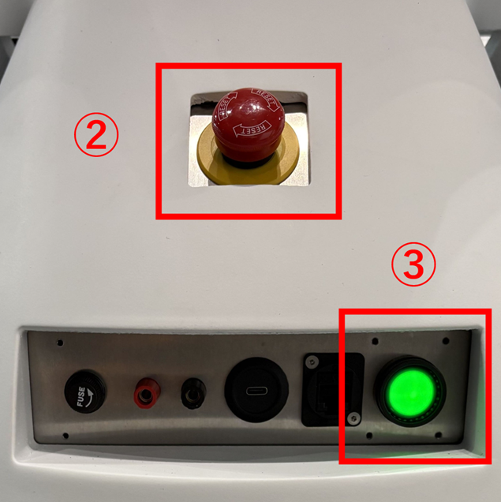
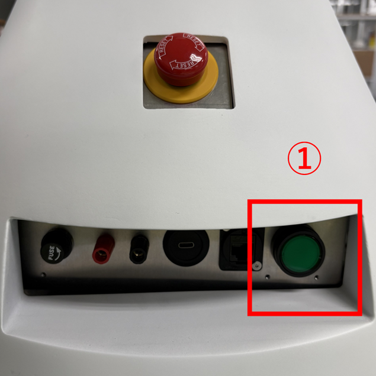

# Indyマニュアル

## 1. 概要

本リポジトリでは、以下の2つのロボットシステムを動かすことができる。

|システム|概要|使用するマシン|
|---|---|---|
|Indy|自律対話ロボット|① ロボット搭載マシン、② サーバマシン|
|robodj|2台のロボット(dj_ri、dj_ken)による会話システム。本リポジトリの機能を使った、Indyとは別のロボットシステム|③ robodj、② サーバマシン(MongoDB・時刻同期のみ)|

Indyを動かすには、① ロボット搭載マシンと② サーバマシンの両方を構築する必要がある(③ robodjは不要)。  
robodjを動かす場合は、③ robodjを構築し、MongoDBを② サーバマシン上に構築する。

各マシンで動作するソフトウェアの構成(起動スクリプトの一覧)、マシン間の通信、MongoDBのデータ構成は、[Indyソフトウェア仕様書.md](../仕様書/Indyソフトウェア仕様書.md)を参照すること。  
ロボット本体の機器構成は、[Indyハードウェア仕様書.md](../仕様書/Indyハードウェア仕様書.md)を参照すること。

## 2. 起動手順

### 2.1. マシンの構築

使用するマシンを構築する。  
Indyを動かす場合はロボット搭載マシンとサーバマシン、robodjを動かす場合はrobodjとサーバマシンを構築する。  
それぞれ以下の手順書を参照すること。

※ロボット搭載マシン、robodjはサーバマシン上のMongoDBに接続する。  
　先にサーバマシンを構築し、MongoDBを構築しておくこと(サーバマシン構築.mdの「5. MongoDBの構築」)。  
　MongoDBは、対話式のツール`setup/mongo_docker/setup_mongo.sh`で構築する。  
　MongoDBは2種類あり、全ロボット共通の設定DB(既定のポート9100)と、ロボットごとのロボットDB(ロボットN台目は9100+10×N。1台目は9110)を使う。  
　設定DBとロボットDBの中身は、[Indyソフトウェア仕様書.md](../仕様書/Indyソフトウェア仕様書.md)の「3. MongoDBのデータ構成」を参照すること。

- サーバマシン(Indy・robodj共通。MongoDBの構築を含む)
  - [docs/手順書/サーバマシン構築.md](../手順書/サーバマシン構築.md)
- ロボット搭載マシン(Indy)
  - [docs/手順書/indy_ロボット搭載マシン構築.md](../手順書/indy_ロボット搭載マシン構築.md)
- robodj(robodjを使う場合のみ)
  - [docs/手順書/robodj構築.md](../手順書/robodj構築.md)

### 2.2. 起動スクリプトの配置

起動スクリプト(module_launch)と運用ツール(tools/bin)は、ホームディレクトリに作成したシンボリックリンクから使用する。  
どのマシンでも、ホームディレクトリで`module_launch/module_launch.sh`のように起動できる。  
配置手順は、各マシンの構築手順書の「起動スクリプトの準備」を参照すること。

- ロボット搭載マシン: [indy_ロボット搭載マシン構築.md](../手順書/indy_ロボット搭載マシン構築.md)の「12. 起動スクリプトの準備」
- サーバマシン: [サーバマシン構築.md](../手順書/サーバマシン構築.md)の「9. 起動スクリプトの準備」
- robodj: [robodj構築.md](../手順書/robodj構築.md)の「7. 起動スクリプトの準備」

tmuxが起動している状態でtmuxの設定を変更した場合は、以下のコマンドを実行して反映させる。
```
tmux source ~/.tmux.conf
```

### 2.3. ロボットの電源を入れる

1. 充電済みのバッテリーをロボットに取り付ける。

2. 非常停止ボタンが解放されていることを確認する。

3. 電源ボタンを押下し、ロボットの電源を入れる。  
   ボタンが緑色に点灯すれば、起動完了。  
   

### 2.4. ソフトウェアの起動

それぞれの環境ごとにIndyの起動方法を示す。  
サーバマシンの場合も、起動スクリプトはホスト上(コンテナ外)で実行する。  

① 機能の一括起動方法  
② 機能の個別起動方法  
③ WindowsマシンでのAudioTracker関連機能の起動方法

#### ① 機能の一括起動方法

1. 機能を起動したいユーザ/マシンにssh接続する。
   ```
   ssh <ユーザ名>@<マシン名>
   ```

2. modules/module_launch/availableに格納されているスクリプト群から、  
   一括起動したいスクリプトのシンボリックリンクをenableフォルダに作成する。  
   ※標準の組み合わせは、各マシンの構築手順書の「起動スクリプトの準備」で登録済みである。追加・変更する場合のみ実施する。
   ```
   cd ~/module_launch/enable
   ln -s ../available/<スクリプト名> .
   ```

3. module_launch.shを実行する。
   ```
   ~/module_launch/module_launch.sh
   ```

#### ② 機能の個別起動方法

1. 機能を起動したいユーザ/マシンにssh接続する。
   ```
   ssh <ユーザ名>@<マシン名>
   ```

2. check_sessions.shで起動したい機能が既に起動していないか確認する。  
   二重起動を防ぐため、起動していた場合は停止する。
   ```
   ~/module_launch/check_sessions.sh

   # 起動していた場合は停止
   tmux send-keys -t <セッション名> C-c
   ```

3. 起動したいスクリプトを実行する。  
   MongoDBの接続先は以下のいずれかの方法で指定することができる。
   ```
   # 環境変数を使用する場合、引数不要
   ~/module_launch/enable(or available)/--.sh
 
   # 引数で設定する場合
   ~/module_launch/enable(or available)/--.sh <MONGO_URI> <MONGO_PORT>
   ```

#### ③ WindowsマシンでのAudioTracker関連機能の起動方法

★TODO

### 2.5. シナリオの起動

シナリオは、シナリオマネージャ(`modules/scenario_manager/rism2`)が実行する。  
シナリオマネージャは設定DBの`rism_configs`を読み、そこに書かれたロボットDBからシナリオを読む(「5.2. 新規シナリオの追加」参照)。  
起動には`uv`が必要である(初回の起動時に依存パッケージが自動でインストールされる)。

1. シナリオ起動マシン(通常はロボット搭載マシン。robodjの場合はrobodj)にて、以下のコマンドを実行する。
   ```
   ~/module_launch/scenario_launch.sh
   ```
   tmuxセッション`scenario_manager`で、以下のコマンドが実行される。
   ```
   cd $GUARDIAN_ROBOT_PATH/modules/scenario_manager/rism2
   uv run main.py --robots $SCENARIO_ROBOTS --demo $SCENARIO_DEMO --host $RISM_CONFIG_HOST --port $RISM_CONFIG_PORT
   ```

   使用する環境変数(~/indy.envで設定する)を以下に示す。

   |環境変数|内容|未設定の場合|
   |---|---|---|
   |`GUARDIAN_ROBOT_PATH`|リポジトリのパス|起動しない(必須)|
   |`SCENARIO_ROBOTS`|シナリオの対象ロボット(設定DBの`robot_list`の`robot_id`)。空白区切りで複数指定可|`ROBOT_NAME`|
   |`SCENARIO_DEMO`|デモID(設定DBの`demo_list`の`demo_id`)|`<SCENARIO_ROBOTSの先頭のロボット名>_demo`|
   |`RISM_CONFIG_HOST`|設定DBのホスト名|`MONGO_URI`|
   |`RISM_CONFIG_PORT`|設定DBのポート番号|`9100`|

   ※`MONGO_PORT`(ロボットDBのポート番号)は使用しない。ロボットDBの場所は、設定DBの`robot_list`、`demo_list`に書かれている。  
   ※`RISM_CONFIG_HOST`、`RISM_CONFIG_PORT`は、設定DBをロボットDBと別のサーバ、または9100以外のポートに置いた場合のみ設定する。  
   　`SCENARIO_DEMO`は、デモIDを既定と異なる値にした場合のみ設定する。  
   　設定すべき値は、MongoDBの構築時に`setup_mongo.sh`が最後に表示する。

   robodjのように1台のマシンで複数のロボットのシナリオを実行する場合は、~/indy.envに以下を設定する。  
   シナリオの`actor`の`robot1`、`robot2`、…は、`SCENARIO_ROBOTS`に指定した順にロボットに対応する。  
   デモIDの既定は先頭のロボット名から決まる(下記の場合は`dj_ri_demo`)ため、異なる場合は`SCENARIO_DEMO`も設定する。
   ```
   export SCENARIO_ROBOTS="dj_ri dj_ken"
   ```

シナリオの停止は、「3.1. ソフトウェアの終了」を参照すること(セッション名は`scenario_manager`)。

## 3. 終了手順

### 3.1. ソフトウェアの終了

それぞれの環境ごとにIndyの終了方法を示す。  

① 機能の一括終了方法  
② 機能の個別終了方法  
③ WindowsマシンでのAudioTracker関連機能の終了方法

#### ① 機能の一括終了方法
1. 停止したいマシンにて、以下のコマンドを実行する。  
   `enable`に登録した各セッションと、シナリオ(scenario_manager)が停止する。
   ```
   ~/module_launch/kill_sessions.sh
   ```

#### ② 機能の個別終了方法
1. check_sessions.shで起動中のセッションを確認し、終了したいセッションを停止する。
   ```
   ~/module_launch/check_sessions.sh

   # 終了したいセッションを停止
   tmux send-keys -t <セッション名> C-c
   ```

#### ③ WindowsマシンでのAudioTracker関連機能の終了方法

★TODO

### 3.2. ロボットの電源を切る

1. 電源ボタンを押下し、ロボットの電源を切る。  
   電源ボタンが消灯すれば、シャットダウン完了。  
   

## 4. 操作方法

### 4.1. マシン間のROS通信(zenoh)

> **注意**  
> ROSの通信は、各マシン内に限定する設定にしている(~/indy.envの`CYCLONEDDS_URI`で読み込むcyclonedds.xml)。  
> そのため、**別のマシンからROSトピックにアクセスする場合は、zenoh-bridge-ros2ddsの設定が必須**である。  
> 設定していないマシンからは、`ros2 topic list`などを実行してもトピックが見えず、操作コマンドも届かない。

- ロボット搭載マシン、robodjは待ち受け側、サーバマシンは接続側として、起動スクリプト`000_zenoh_bridge`で起動する(各マシンの構築手順書参照)。
- rviz用のマシンなど、他のマシンをつなぐ場合は、そのマシンで以下を行う。
  1. Ubuntu 22.04、ROS 2 humbleをインストールし、guardian_robot_systemリポジトリをクローンする。
  2. [indy_ロボット搭載マシン構築.md](../手順書/indy_ロボット搭載マシン構築.md)の「3. zenoh-bridge-ros2ddsのインストール」を実施する。
  3. 以下の環境変数を設定する(`ROS_DOMAIN_ID`は接続先と同じ値)。
     ```
     export GUARDIAN_ROBOT_PATH=<guardian_robot_systemのパス>
     export ROS_DOMAIN_ID=<接続先と同じROS_DOMAIN_ID>
     export RMW_IMPLEMENTATION=rmw_cyclonedds_cpp
     export CYCLONEDDS_URI=file://$GUARDIAN_ROBOT_PATH/setup/ros2/zenoh/cyclonedds.xml
     ```
  4. 以下のコマンドを実行し、接続先(ロボット搭載マシンまたはrobodj)のブリッジに接続する。  
     ※ポート番号は、接続先の`ZENOH_PORT`(未設定の場合は7447)に合わせる。
     ```
     ROS_DISTRO=humble zenoh-bridge-ros2dds -c $GUARDIAN_ROBOT_PATH/setup/ros2/zenoh/bridge_server.json5 -d $ROS_DOMAIN_ID -e tcp/<接続先のIPアドレス>:7447
     ```
  5. 別のターミナルで`ros2 topic list`を実行し、接続先のトピックが見えることを確認する。

  ※サーバマシンと他のマシンが、同時に1台のロボットへ接続する構成は動作未確認。

### 4.2. 主なROSトピックによる操作方法

以下のコマンドは、ロボット搭載マシン上、またはzenohでロボット搭載マシンに接続したマシン上で実行する(「4.1. マシン間のROS通信(zenoh)」参照)。

#### ① キーボードによるローバ操作

以下のコマンドを実行すると、キーボードによるローバ操作が可能となる。
```
ros2 run teleop_twist_keyboard teleop_twist_keyboard --ros-args -r /cmd_vel:=/<ロボット名>/rover/cmd_vel
```

※ロボット搭載マシンでは、同じ内容を`33_teleop_keyboard.sh`(tools/bin、トピック名に`ROBOT_NAME`を使用)でも起動できる。

- 操作方法
  - iキー: 前進
  - kキー: 停止
  - ,キー: 後退
  - jキー: 左回転
  - lキー: 右回転
  - qキー: ロボット速度上昇
  - zキー: ロボット速度減少

#### ② 直進(後退)指令

以下のコマンドを実行すると、指定した距離だけ直進(後退)する。
```
ros2 topic pub /<ロボット名>/rover/move_straight std_msgs/msg/Float32 "data: <距離>" -1
```

- 距離  
  メートル単位で設定する(e.g. 1.0、-5.0)。  
  正の値で直進、負の値で後退する。

#### ③ 回転指令

以下のコマンドを実行すると、指定した角度だけ回転する。
```
ros2 topic pub /<ロボット名>/rover/rotate std_msgs/msg/Float32 "data: <角度>" -1
```

- 角度  
  ラジアン単位で設定する(e.g. 1.0、-2.0)。  
  正の値で反時計周りに、負の値で時計回りに回転する。

#### ④ ナビゲーション指令

以下のコマンドを実行すると、指定した位置に移動する。
```
ros2 topic pub /<ロボット名>/rover/navigate common_msgs/msg/PoseAngle "header:
  stamp:
    sec: 0
    nanosec: 0
  frame_id: ''
position:
  x: <x座標>
  y: <y座標>
  z: 0.0
angle: <向き>" -1
```

- x座標・y座標  
  メートル単位で、原点からの絶対位置を設定する(e.g. 1.0、-5.0)。
- 向き  
  ラジアン単位で、原点からの絶対角度を設定する(e.g. 1.0、-2.0)。
     
#### ⑤ 現在位置設定指令

以下のコマンドを実行すると、現在位置の設定を行う。  
現在の位置がずれていた場合に使用する。
```
ros2 topic pub /<ロボット名>/rover/set_initialpose common_msgs/msg/PoseAngle "header:
  stamp:
    sec: 0
    nanosec: 0
  frame_id: ''
position:
  x: <x座標>
  y: <y座標>
  z: 0.0
angle: <向き>" -1
```

- x座標・y座標  
  メートル単位で、原点からの絶対位置を設定する(e.g. 1.0、-5.0)。
- 向き  
  ラジアン単位で、原点からの絶対角度を設定する(e.g. 1.0、-2.0)。

#### ⑥ 停止指令

ローバ移動中に以下のコマンドを実行すると、ローバを停止する。
```
ros2 topic pub /<ロボット名>/rover/stop std_msgs/msg/Empty "{}" -1
```

#### ⑦ 腕の角度変更指令

以下のコマンドを実行すると、関節数分の腕のモータを指定した角度にまとめて変更する。
```
# 腕の全モータ有効化
ros2 topic pub /<ロボット名>/<アーム名>/enable std_msgs/msg/Empty "{}" -1

# 腕の角度変更
ros2 topic pub /<ロボット名>/<アーム名>/goal_joints sensor_msgs/msg/JointState "header:
  stamp:
    sec: 0
    nanosec: 0
  frame_id: ''
name: []
position: [<第1ジョイント位置>, <第2ジョイント位置>, <第3ジョイント位置>, <第4ジョイント位置>]
velocity: []
effort: []" -1
```

- アーム名  
  `right_arm`と`left_arm`のどちらかを設定する。

- 各ジョイント位置  
  - `arm_motor_control/config/arm_motor_control.yaml`の`max_position`と`min_position`の範囲内で、ラジアン単位で設定する。
  - **`name` フィールドは使用されない。**  
    受信側は `position` のみを参照するため、値は`arm_motor_control.yaml`の`joint_names`パラメータの並び順（bracket_arm_a → b → c → d）で指定すること。  
    順序を誤ると意図しない関節が動作する。

#### ⑧ 首、腰の角度変更指令

以下のコマンドを実行すると、首、腰のモータを指定した角度に変更する。
```
ros2 topic pub /<ロボット名>/motor_control/control_position sensor_msgs/msg/JointState "header:
  stamp:
    sec: 0
    nanosec: 0
  frame_id: ''
name: ["<ロボット名>_neck_yaw_joint", "<ロボット名>_neck_pitch_joint", "<ロボット名>_body_pitch_joint"]
position: [<首のジョイント位置(yaw)>, <首のジョイント位置(pitch)>, <腰のジョイント位置(pitch)>]
velocity: []
effort: []" -1
```

- 各ジョイント位置  
  - `motor_driver/motor_control/config/motor_control.yaml`の`max_position`と`min_position`の範囲内で、ラジアン単位で設定する。

#### ⑨ 充電開始指令

以下のコマンドを実行すると、ロボットの背後3m x 3mの空間内の充電ステーションを探し、自動ドッキングを行う。
```
ros2 topic pub /<ロボット名>/auto_charge/dock_start std_msgs/msg/Empty "{}" -1
```

## 5. 設定の変更

### 5.1. MongoDBでのパラメータ設定

各Documentとそれを読み込むモジュールの対応は、[Indyソフトウェア仕様書.md](../仕様書/Indyソフトウェア仕様書.md)の「3.1. パラメータ」を参照すること。  
各モジュールは起動時にパラメータを読み込むため、変更後は対象モジュールを再起動すること(「6.2. 機能の個別再起動」参照)。

MongoDBは、設定DBとロボットDBの2種類がある。主なパラメータの置き場所を以下に示す。  
詳細は、[Indyソフトウェア仕様書.md](../仕様書/Indyソフトウェア仕様書.md)の「3. MongoDBのデータ構成」を参照すること。

|MongoDB|既定のポート|主なDatabase/Collection|内容|
|---|---|---|---|
|設定DB(全ロボット共通)|9100|`rism_configs`/`rism_config`|シナリオマネージャの設定|
|||`rism_configs`/`robot_list`|ロボットごとの設定(接続するDB、LLM、音声認識の設定など)|
|||`rism_configs`/`demo_list`|デモごとの設定(シナリオを読むDB)|
|||`rism_configs`/`common`|全ロボット共通の設定(天気の取得など)|
|ロボットDB(ロボットごと)|9100+10×N(1台目は9110)|`robot_config`/`system_parameters`|各モジュールのパラメータ(「3.1. パラメータ」)|
|||`demo_configs`/`scenarios`など|シナリオ(「5.2. 新規シナリオの追加」)|
|||`memory_settings`、`persona`|LLMのプロンプト、ジェスチャーの定義など|
|||`tBlackBoard`|観測、ロボットへの動作指示、実行中の状態など(ロボット・シナリオマネージャが書き込む)|

1. ブラウザでMongoDB管理画面(Web UI)に接続する。  
   URLは`http://<MongoDBサーバのホスト名>:<MongoDBのポート番号+1>/`である(e.g. 設定DBは9101、1台目のロボットDBは9111)。  
   Web UIの種類(mongo-express、DbGate、なし)は、MongoDBの構築時に`setup_mongo.sh`で選択する。  
   ※mongo-expressは、MongoDBごとに1つ起動する(各MongoDBのポート番号+1)。  
   ※DbGateは、composeファイルごとに1つ起動し、その中のすべてのMongoDBを扱う(設定DBとロボットDBを同じサーバに置いた場合は、設定DBのポート番号+1)。  
   ※Web UIはログインなしで、同じネットワーク内の他のマシンから開ける。信頼できるネットワーク内でのみ使用すること。  
   以降の手順は、mongo-expressの画面での操作を示す。

2. ロボットDBのWeb UIで、Databasesの中から、「robot_config」を押下する。

3. Collectionsの中から、「system_parameters」を押下する。

4. 変更したいモジュールのDocument(`name`の値で判別する。[Indyソフトウェア仕様書.md](../仕様書/Indyソフトウェア仕様書.md)の「3.1. パラメータ」参照)を押下する。

5. Document編集画面にて、対象のパラメータを変更する。

6. 「Save」ボタンを押下する。

### 5.2. 新規シナリオの追加

シナリオは、ロボットDBの`demo_configs`に置く。  
どのDBのシナリオを使うかは、設定DBの`rism_configs`/`demo_list`のデモ(`SCENARIO_DEMO`で指定したデモID)に書かれている(既定ではロボットDBの`demo_configs`)。  
シナリオの書き方の詳細(全フィールド、条件の書き方、イベントの種類、Event Generator)は、[modules/scenario_manager/rism2/docs/SCENARIO_SCHEMA.md](../../modules/scenario_manager/rism2/docs/SCENARIO_SCHEMA.md)を参照すること。  
サンプルは[modules/scenario_manager/rism2/samples/](../../modules/scenario_manager/rism2/samples/)にある(MongoDBの構築時にサンプルを入れることを選んだ場合は、ロボットDBに登録済みである)。

|Collection|内容|
|---|---|
|`scenarios`|メインシナリオ。`status`が`active`で`condition`に合うものから、`priority`を重みにして次に実行するものを選ぶ|
|`interruption_subscenarios`|割り込みサブシナリオ。`condition`に合う観測(音声認識、顔検出など)が来たら、実行中のシナリオに割り込んで実行する|
|`knowledge`|KnowledgeEventGeneratorが使う知識|

※旧シナリオマネージャの`rism_configs`/`scenarios`、`interruption_subscenarios`、`interaction_subscenarios`は使用しない。旧形式のフィールド(`trigger`、`'return'`、`interaction_subscenario_ids`、`utterance`など)も使えない。  
※シナリオ切り替え用のWeb UI(`modules/indy_modules/scenario_switchboard`)を使うと、ロボットDBの`demo_configs`/`scenarios`、`interruption_subscenarios`の`status`(`active`/`inactive`)を一覧から切り替えられる。起動方法は[README](../../modules/indy_modules/scenario_switchboard/README.md)を参照。

1. ブラウザでロボットDBのMongoDB管理画面(Web UI)に接続する(「5.1. MongoDBでのパラメータ設定」参照)。

2. Databasesの中から、「demo_configs」を押下する。

3. Collectionsの中から、「scenarios」、「interruption_subscenarios」のいずれかを押下する。

4. 画面左上の「New Document」ボタンを押下する。

5. Add Document画面で、シナリオを入力する。
   - scenariosの入力例(発話とジェスチャーの後、指定位置へ移動して発話する)
      ```
      {
        "name": "受付で案内",
        "status": "active",
        "version": "2.0",
        "priority": 100,
        "condition": {},
        "events": [
          {
            "actor": "robot1",
            "type": "action",
            "interruptable": false,
            "speak": {"type": "normal", "option": {"text": "受付へ移動します。"}},
            "gesture": {"type": "normal", "option": {"command": "raise_hand", "duration": 2}}
          },
          {
            "actor": "robot1",
            "type": "action",
            "interruptable": true,
            "navigation": {"type": "normal", "option": {"navigation": [1.0, -5.0, 1.57]}}
          },
          {
            "actor": "robot1",
            "type": "action",
            "interruptable": true,
            "speak": {"type": "normal", "option": {"text": "ご用の方は声をかけてください。"}}
          }
        ],
        "next_scenarios": []
      }
      ```

   - interruption_subscenariosの入力例(「こんにちは」「おはよう」と話しかけられたら返事をし、元のシナリオの続きに戻る)
      ```
      {
        "name": "あいさつへの返事",
        "status": "active",
        "version": "2.0",
        "priority": 100,
        "condition": {"asr": {"text": {"$regex": "こんにちは|おはよう"}}},
        "resume_after": "resume",
        "ignore_after_activated": 30,
        "ignore_same_observations": true,
        "events": [
          {
            "actor": "robot1",
            "type": "action",
            "interruptable": false,
            "speak": {"type": "normal", "option": {"text": "こんにちは！声をかけてくれてありがとうございます。"}},
            "gesture": {"type": "normal", "option": {"command": "bowing_max", "duration": 2}}
          }
        ]
      }
      ```

   - 主なフィールドの内容は、[Indyソフトウェア仕様書.md](../仕様書/Indyソフトウェア仕様書.md)の「3.2. シナリオ関連のコレクション」「3.3. eventsフィールド」を参照すること。
   - 座標(`navigation`)は、使用する地図に合わせて変更すること。`gesture`の`command`には、ロボットDBの`persona`/`ActionPrimitives`の`name`の値を記載する。
   - `next_scenarios`(次に実行するシナリオ)、`ignore_interruptions`(実行中は発動させないサブシナリオ)、`include`イベントの`scenario`には、参照先のシナリオの`_id`(24桁の16進数の文字列。e.g. `"6650a1b2c3d4e5f601234567"`)を記載する。  
     `_id`は、参照先のDocumentをWeb UIで開いて確認する。  
     ※サンプルのJSONにある`"@名前"`の形式は、サンプルの登録時にツールが`_id`に置き換えるためのもので、Web UIから直接登録する場合は使えない。

6. 「Save」ボタンを押下する。

追加・変更したシナリオは、シナリオマネージャを再起動しなくても反映される(メインシナリオは次のシナリオを選ぶときに読み込み、サブシナリオは変更を検知して読み直す)。  
シナリオの形がスキーマ(`modules/scenario_manager/rism2/src/rism2/schemas/scenario.schema.json`)に合わない場合は、シナリオマネージャのログに警告が出る(実行は止まらない)。  
不要になったシナリオは、Documentを削除するか、`status`を`inactive`にする(`inactive`のシナリオは自動では選ばれないが、`next_scenarios`、`include`からは実行できる)。

## 6. トラブル時の対応

### 6.1. レスキューモード

ロボット搭載マシンでは、レスキューモード監視(00_hv_watch)が常駐し、以下のいずれかを検知するとレスキューモードに移行する。  
詳細は[modules/module_launch/rescue_mode/README.md](../../modules/module_launch/rescue_mode/README.md)を参照すること。

- MongoDBを動かすマシンへのpingが、3回連続で無応答または1000ms超となった
- 停止中のセッションが3つ以上になった(既定値)
- 直近3件のナビゲーションがすべて失敗した(既定値)

レスキューモードに移行すると、以下のように動作する。

1. Slackに`[<ロボット名>] レスキューモードに移行します。理由: <原因>`が通知される。
2. 各セッションが停止し、助けを求める音声がくり返し再生される。また、タイヤが解放される。
3. Slackに`[<ロボット名>] レスキューモードに入りました。充電ステーションへの誘導をお願いします。`が通知される。  
   この通知を受けたら、ロボットを充電ステーションへ誘導する。
4. 充電が始まったことを検知すると、ソフトウェアを起動し直して通常モードに戻る。  
   すべてのセッションが起動し、初期位置を設定できれば、Slackに`[<ロボット名>] 通常モードに戻りました。`が通知される。  
   起動していないセッションがある場合などは、`[<ロボット名>] 通常モードへの復帰処理を終えましたが、問題があります。<内容> 確認をお願いします。`が通知される。この場合は「6.2. 機能の個別再起動」に従い、該当するセッションを起動する。

※Slackへの通知は、~/indy.envの`SLACK_WEBHOOK_URL`を設定した場合のみ行われる。

### 6.2. 機能の個別再起動

特定の機能が停止した場合や、パラメータを変更した場合は、該当するセッションを個別に停止・起動する。  
手順は「3.1. ソフトウェアの終了」の「② 機能の個別終了方法」と、「2.4. ソフトウェアの起動」の「② 機能の個別起動方法」を参照すること。

### 6.3. コンテナの動作確認(サーバマシン)

サーバマシンのソフトウェアはコンテナ上で動作するが、起動スクリプト(50_grsrv_\*.sh、000_zenoh_bridge.sh)が自動でコンテナを起動するため、  
「2.4. ソフトウェアの起動」の前にコンテナを起動しておく必要はない。  
本節の手順は、コンテナ単体の動作確認やデバッグを行う場合に使用する。  
コンテナの構築手順については、[docs/手順書/サーバマシン構築.md](../手順書/サーバマシン構築.md)の「6. Apptainerの設定」参照。

1. 以下のコマンドを実行し、生成したコンテナイメージを起動する。
   ```
   cd $GUARDIAN_ROBOT_PATH/setup/container_image
   apptainer shell --nv ros2_12-6-3_on_server.sif
   ```

   以下のようなプロンプトが表示されれば起動成功。
   ```
   Apptainer>
   ```

2. コンテナを終了する場合は、以下のコマンドを実行する。
   ```
   exit
   ```
