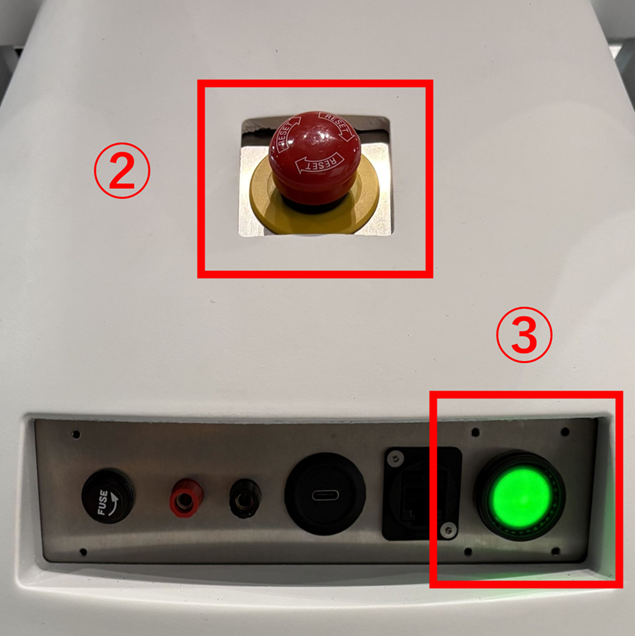
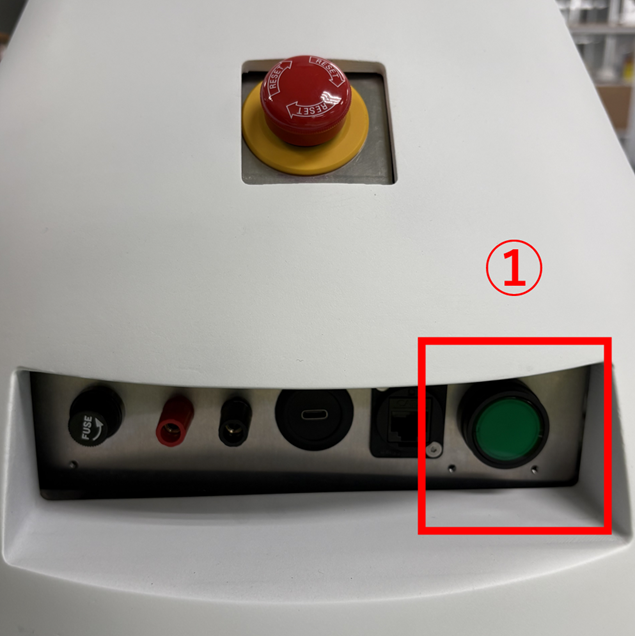

# Indyマニュアル

## 1. 概要

本リポジトリでは、以下の2つのロボットシステムを動かすことができる。

|システム|概要|使用するマシン|
|---|---|---|
|Indy|自律対話ロボット|① ロボット搭載マシン、② サーバマシン|
|robodj|2台のロボット(dj_ri、dj_ken)による会話システム。本リポジトリの機能を使った、Indyとは別のロボットシステム|③ robodj、② サーバマシン(MongoDB・時刻同期のみ)|

Indyを動かすには、① ロボット搭載マシンと② サーバマシンの両方を構築する必要がある(③ robodjは不要)。  
robodjを動かす場合は、③ robodjを構築し、MongoDBを② サーバマシン上に構築する。

各マシンで動作するソフトウェアの構成(起動スクリプトの一覧)、マシン間の通信、MongoDBのデータ構成は、[Indyソフトウェア仕様書.md](../仕様書/Indyソフトウェア仕様書.md)を参照すること。  
ロボット本体の機器構成は、[Indyハードウェア仕様書.md](../仕様書/Indyハードウェア仕様書.md)を参照すること。

## 2. 起動手順

### 2.1. マシンの構築

使用するマシンを構築する。  
Indyを動かす場合はロボット搭載マシンとサーバマシン、robodjを動かす場合はrobodjとサーバマシンを構築する。  
それぞれ以下の手順書を参照すること。

※ロボット搭載マシン、robodjはサーバマシン上のMongoDBに接続する。  
　先にサーバマシンを構築し、MongoDBを構築しておくこと(サーバマシン構築.mdの「5. MongoDBの構築」)。

- サーバマシン(Indy・robodj共通。MongoDBの構築を含む)
  - [docs/手順書/サーバマシン構築.md](../手順書/サーバマシン構築.md)
- ロボット搭載マシン(Indy)
  - [docs/手順書/indy_ロボット搭載マシン構築.md](../手順書/indy_ロボット搭載マシン構築.md)
- robodj(robodjを使う場合のみ)
  - [docs/手順書/robodj構築.md](../手順書/robodj構築.md)

### 2.2. 起動スクリプトの配置

起動スクリプト(module_launch)と運用ツール(tools/bin)は、ホームディレクトリに作成したシンボリックリンクから使用する。  
どのマシンでも、ホームディレクトリで`module_launch/module_launch.sh`のように起動できる。  
配置手順は、各マシンの構築手順書の「起動スクリプトの準備」を参照すること。

- ロボット搭載マシン: [indy_ロボット搭載マシン構築.md](../手順書/indy_ロボット搭載マシン構築.md)の「12. 起動スクリプトの準備」
- サーバマシン: [サーバマシン構築.md](../手順書/サーバマシン構築.md)の「9. 起動スクリプトの準備」
- robodj: [robodj構築.md](../手順書/robodj構築.md)の「7. 起動スクリプトの準備」

tmuxが起動している状態でtmuxの設定を変更した場合は、以下のコマンドを実行して反映させる。
```
tmux source ~/.tmux.conf
```

### 2.3. ロボットの電源を入れる

1. 充電済みのバッテリーをロボットに取り付ける。

2. 非常停止ボタンが解放されていることを確認する。

3. 電源ボタンを押下し、ロボットの電源を入れる。  
   ボタンが緑色に点灯すれば、起動完了。  
   

### 2.4. ソフトウェアの起動

それぞれの環境ごとにIndyの起動方法を示す。  
サーバマシンの場合も、起動スクリプトはホスト上(コンテナ外)で実行する。  

① 機能の一括起動方法  
② 機能の個別起動方法  
③ WindowsマシンでのAudioTracker関連機能の起動方法

#### ① 機能の一括起動方法

1. 機能を起動したいユーザ/マシンにssh接続する。
   ```
   ssh <ユーザ名>@<マシン名>
   ```

2. modules/module_launch/availableに格納されているスクリプト群から、  
   一括起動したいスクリプトのシンボリックリンクをenableフォルダに作成する。  
   ※標準の組み合わせは、各マシンの構築手順書の「起動スクリプトの準備」で登録済みである。追加・変更する場合のみ実施する。
   ```
   cd ~/module_launch/enable
   ln -s ../available/<スクリプト名> .
   ```

3. module_launch.shを実行する。
   ```
   ~/module_launch/module_launch.sh
   ```

#### ② 機能の個別起動方法

1. 機能を起動したいユーザ/マシンにssh接続する。
   ```
   ssh <ユーザ名>@<マシン名>
   ```

2. check_sessions.shで起動したい機能が既に起動していないか確認する。  
   二重起動を防ぐため、起動していた場合は停止する。
   ```
   ~/module_launch/check_sessions.sh

   # 起動していた場合は停止
   tmux send-keys -t <セッション名> C-c
   ```

3. 起動したいスクリプトを実行する。  
   MongoDBの接続先は以下のいずれかの方法で指定することができる。
   ```
   # 環境変数を使用する場合、引数不要
   ~/module_launch/enable(or available)/--.sh
 
   # 引数で設定する場合
   ~/module_launch/enable(or available)/--.sh <MONGO_URI> <MONGO_PORT>
   ```

#### ③ WindowsマシンでのAudioTracker関連機能の起動方法

★TODO

### 2.5. シナリオの起動

1. シナリオ起動マシンにて、以下のコマンドを実行する。
   ```
   ~/module_launch/scenario_launch.sh
   ```

   シナリオの対象ロボットは、環境変数`SCENARIO_ROBOTS`(空白区切りで複数指定可)で指定する。  
   未設定の場合は`ROBOT_NAME`のロボットが対象となる。  
   robodjのように1台のマシンで複数のロボットのシナリオを実行する場合は、~/indy.envに以下を設定する。
   ```
   export SCENARIO_ROBOTS="dj_ri dj_ken"
   ```

## 3. 終了手順

### 3.1. ソフトウェアの終了

それぞれの環境ごとにIndyの終了方法を示す。  

① 機能の一括終了方法  
② 機能の個別終了方法  
③ WindowsマシンでのAudioTracker関連機能の終了方法

#### ① 機能の一括終了方法
1. 停止したいマシンにて、以下のコマンドを実行する。  
   `enable`に登録した各セッションと、シナリオ(scenario_manager)が停止する。
   ```
   ~/module_launch/kill_sessions.sh
   ```

#### ② 機能の個別終了方法
1. check_sessions.shで起動中のセッションを確認し、終了したいセッションを停止する。
   ```
   ~/module_launch/check_sessions.sh

   # 終了したいセッションを停止
   tmux send-keys -t <セッション名> C-c
   ```

#### ③ WindowsマシンでのAudioTracker関連機能の終了方法

★TODO

### 3.2. ロボットの電源を切る

1. 電源ボタンを押下し、ロボットの電源を切る。  
   電源ボタンが消灯すれば、シャットダウン完了。  
   

## 4. 操作方法

### 4.1. マシン間のROS通信(zenoh)

> **注意**  
> ROSの通信は、各マシン内に限定する設定にしている(~/indy.envの`CYCLONEDDS_URI`で読み込むcyclonedds.xml)。  
> そのため、**別のマシンからROSトピックにアクセスする場合は、zenoh-bridge-ros2ddsの設定が必須**である。  
> 設定していないマシンからは、`ros2 topic list`などを実行してもトピックが見えず、操作コマンドも届かない。

- ロボット搭載マシン、robodjは待ち受け側、サーバマシンは接続側として、起動スクリプト`000_zenoh_bridge`で起動する(各マシンの構築手順書参照)。
- rviz用のマシンなど、他のマシンをつなぐ場合は、そのマシンで以下を行う。
  1. Ubuntu 22.04、ROS 2 humbleをインストールし、guardian_robot_systemリポジトリをクローンする。
  2. [indy_ロボット搭載マシン構築.md](../手順書/indy_ロボット搭載マシン構築.md)の「3. zenoh-bridge-ros2ddsのインストール」を実施する。
  3. 以下の環境変数を設定する(`ROS_DOMAIN_ID`は接続先と同じ値)。
     ```
     export GUARDIAN_ROBOT_PATH=<guardian_robot_systemのパス>
     export ROS_DOMAIN_ID=<接続先と同じROS_DOMAIN_ID>
     export RMW_IMPLEMENTATION=rmw_cyclonedds_cpp
     export CYCLONEDDS_URI=file://$GUARDIAN_ROBOT_PATH/setup/ros2/zenoh/cyclonedds.xml
     ```
  4. 以下のコマンドを実行し、接続先(ロボット搭載マシンまたはrobodj)のブリッジに接続する。  
     ※ポート番号は、接続先の`ZENOH_PORT`(未設定の場合は7447)に合わせる。
     ```
     ROS_DISTRO=humble zenoh-bridge-ros2dds -c $GUARDIAN_ROBOT_PATH/setup/ros2/zenoh/bridge_server.json5 -d $ROS_DOMAIN_ID -e tcp/<接続先のIPアドレス>:7447
     ```
  5. 別のターミナルで`ros2 topic list`を実行し、接続先のトピックが見えることを確認する。

  ※サーバマシンと他のマシンが、同時に1台のロボットへ接続する構成は動作未確認。

### 4.2. 主なROSトピックによる操作方法

以下のコマンドは、ロボット搭載マシン上、またはzenohでロボット搭載マシンに接続したマシン上で実行する(「4.1. マシン間のROS通信(zenoh)」参照)。

#### ① キーボードによるローバ操作

以下のコマンドを実行すると、キーボードによるローバ操作が可能となる。
```
ros2 run teleop_twist_keyboard teleop_twist_keyboard --ros-args -r /cmd_vel:=/<ロボット名>/rover/cmd_vel
```

- 操作方法
  - iキー: 前進
  - kキー: 停止
  - ,キー: 後退
  - jキー: 左回転
  - lキー: 右回転
  - qキー: ロボット速度上昇
  - zキー: ロボット速度減少

#### ② 直進(後退)指令

以下のコマンドを実行すると、指定した距離だけ直進(後退)する。
```
ros2 topic pub /<ロボット名>/rover/move_straight std_msgs/msg/Float32 "data: <距離>" -1
```

- 距離  
  メートル単位で設定する(e.g. 1.0、-5.0)。  
  正の値で直進、負の値で後退する。

#### ③ 回転指令

以下のコマンドを実行すると、指定した角度だけ回転する。
```
ros2 topic pub /<ロボット名>/rover/rotate std_msgs/msg/Float32 "data: <角度>" -1
```

- 角度  
  ラジアン単位で設定する(e.g. 1.0、-2.0)。  
  正の値で反時計周りに、負の値で時計回りに回転する。

#### ④ ナビゲーション指令

以下のコマンドを実行すると、指定した位置に移動する。
```
ros2 topic pub /<ロボット名>/rover/navigate common_msgs/msg/PoseAngle "header:
  stamp:
    sec: 0
    nanosec: 0
  frame_id: ''
position:
  x: <x座標>
  y: <y座標>
  z: 0.0
angle: <向き>" -1
```

- x座標・y座標  
  メートル単位で、原点からの絶対位置を設定する(e.g. 1.0、-5.0)。
- 向き  
  ラジアン単位で、原点からの絶対角度を設定する(e.g. 1.0、-2.0)。
     
#### ⑤ 現在位置設定指令

以下のコマンドを実行すると、現在位置の設定を行う。  
現在の位置がずれていた場合に使用する。
```
ros2 topic pub /<ロボット名>/rover/set_initialpose common_msgs/msg/PoseAngle "header:
  stamp:
    sec: 0
    nanosec: 0
  frame_id: ''
position:
  x: <x座標>
  y: <y座標>
  z: 0.0
angle: <向き>" -1
```

- x座標・y座標  
  メートル単位で、原点からの絶対位置を設定する(e.g. 1.0、-5.0)。
- 向き  
  ラジアン単位で、原点からの絶対角度を設定する(e.g. 1.0、-2.0)。

#### ⑥ 停止指令

ローバ移動中に以下のコマンドを実行すると、ローバを停止する。
```
ros2 topic pub /<ロボット名>/rover/stop std_msgs/msg/Empty "{}" -1
```

#### ⑦ 腕の角度変更指令

以下のコマンドを実行すると、関節数分の腕のモータを指定した角度にまとめて変更する。
```
# 腕の全モータ有効化
ros2 topic pub /<ロボット名>/<アーム名>/enable std_msgs/msg/Empty "{}" -1

# 腕の角度変更
ros2 topic pub /<ロボット名>/<アーム名>/goal_joints sensor_msgs/msg/JointState "header:
  stamp:
    sec: 0
    nanosec: 0
  frame_id: ''
name: []
position: [<第1ジョイント位置>, <第2ジョイント位置>, <第3ジョイント位置>, <第4ジョイント位置>]
velocity: []
effort: []" -1
```

- アーム名  
  `right_arm`と`left_arm`のどちらかを設定する。

- 各ジョイント位置  
  - `arm_motor_control/config/arm_motor_control.yaml`の`max_position`と`min_position`の範囲内で、ラジアン単位で設定する。
  - **`name` フィールドは使用されない。**  
    受信側は `position` のみを参照するため、値は`arm_motor_control.yaml`の`joint_names`パラメータの並び順（bracket_arm_a → b → c → d）で指定すること。  
    順序を誤ると意図しない関節が動作する。

#### ⑧ 首、腰の角度変更指令

以下のコマンドを実行すると、首、腰のモータを指定した角度に変更する。
```
ros2 topic pub /<ロボット名>/motor_control/control_position sensor_msgs/msg/JointState "header:
  stamp:
    sec: 0
    nanosec: 0
  frame_id: ''
name: ["<ロボット名>_neck_yaw_joint", "<ロボット名>_neck_pitch_joint", "<ロボット名>_body_pitch_joint"]
position: [<首のジョイント位置(yaw)>, <首のジョイント位置(pitch)>, <腰のジョイント位置(pitch)>]
velocity: []
effort: []" -1
```

- 各ジョイント位置  
  - `motor_driver/motor_control/config/motor_control.yaml`の`max_position`と`min_position`の範囲内で、ラジアン単位で設定する。

#### ⑨ 充電開始指令

以下のコマンドを実行すると、ロボットの背後3m x 3mの空間内の充電ステーションを探し、自動ドッキングを行う。
```
ros2 topic pub /<ロボット名>/auto_charge/dock_start std_msgs/msg/Empty "{}" -1
```

## 5. 設定の変更

### 5.1. MongoDBでのパラメータ設定

各Documentとそれを読み込むモジュールの対応は、[Indyソフトウェア仕様書.md](../仕様書/Indyソフトウェア仕様書.md)の「3.1. パラメータ」を参照すること。  
各モジュールは起動時にパラメータを読み込むため、変更後は対象モジュールを再起動すること(「6.2. 機能の個別再起動」参照)。

1. ブラウザでMongoDB管理画面(Mongo Express)に接続する。  
   URLは`http://<MongoDBサーバのホスト名>:<管理画面のポート番号>/`(サーバマシンのmongo.envの`MONGO_PUBLIC_HOST`と`ME_PORT`)。  
   ※他のマシンのブラウザから開くには、サーバマシンのmongo.envで`ME_BIND_ADDR=0.0.0.0`を設定しておく必要がある([サーバマシン構築.md](../手順書/サーバマシン構築.md)の「5. MongoDBの構築」参照)。

2. Databasesの中から、「robot_config」を押下する。

3. Collectionsの中から、「system_parameters」を押下する。

4. 変更したいモジュールのDocument(`name`の値で判別する。[Indyソフトウェア仕様書.md](../仕様書/Indyソフトウェア仕様書.md)の「3.1. パラメータ」参照)を押下する。

5. Document編集画面にて、対象のパラメータを変更する。

6. 「Save」ボタンを押下する。

### 5.2. 新規シナリオの追加

1. ブラウザでMongoDB管理画面(Mongo Express)に接続する(「5.1. MongoDBでのパラメータ設定」参照)。

2. Databasesの中から、「rism_configs」を押下する。

3. Collectionsの中から、「scenarios」、「interruption_subscenarios」、「interaction_subscenarios」のいずれかを押下する。

4. 画面左上の「New Document」ボタンを押下する。

5. Add Document画面で、シナリオを入力する。
   - scenariosの入力例(標準データの「充電ステーションへ移動」)
      ```
      {
         name: '充電ステーションへ移動',
         status: 'inactive',
         priority: 1,
         trigger: [],
         interaction_subscenario_ids: [],
         ignore_after_activated: 30,
         ignore_same_observations: true,
         'return': true,
         events: [
            {
               actor: 'robot1',
               type: 'action',
               utterance: {
                  type: 'normal',
                  sentence: '基地局に移動します。'
               },
               navigation: {
                  type: 'normal',
                  navigation: [6.5, 1.15, 0]
               },
               interruptable: false
            },
            {
               actor: 'robot1',
               type: 'action',
               navigation: {
                  type: 'normal',
                  rotate: 3.14
               },
               interruptable: false
            },
            {
               actor: 'robot1',
               type: 'action',
               interruptable: false,
               utterance: {
                  type: 'normal',
                  sentence: 'ナビゲーション機能を停止します。'
               },
               ros_command: {
                  type: 'normal',
                  topic: '/<ロボット名>/robot/action_ctl',
                  topic_type: 'std_msgs/msg/String',
                  data: 'deactivate nav'
               }
            },
            {
               actor: 'robot1',
               type: 'action',
               interruptable: false,
               utterance: {
                  type: 'normal',
                  sentence: 'バッテリの充電のため，自動でステーションに入ります。'
               }
            },
            {
               actor: 'robot1',
               type: 'action',
               interruptable: false,
               utterance: {
                  type: 'normal',
                  sentence: 'ちゃんと戻れるか，応援してください．'
               },
               ros_command: {
                  type: 'normal',
                  topic: '/<ロボット名>/robot/action_ctl',
                  topic_type: 'std_msgs/msg/String',
                  data: 'battery charge'
               }
            }
         ]
      }
      ```

   - interruption_subscenariosの入力例(標準データの「インディー戻って」)
      ```
      {
         name: 'インディー戻って',
         status: 'active',
         priority: 100,
         'return': false,
         trigger: [
            {
               asr: {
                  text: 'インディー戻って'
               }
            }
         ],
         important: true,
         ignore_after_activated: 5,
         ignore_same_observations: true,
         interaction_subscenario_ids: [],
         next_scenarios: [],
         events: [
            {
               actor: 'robot1',
               type: 'action',
               utterance: {
                  type: 'normal',
                  sentence: 'はい，いったん帰りますね．じゃ！'
               },
               gesture: {
                  type: 'normal',
                  command: 'Look_around'
               },
               navigation: {
                  type: 'normal',
                  navigation: [6.88, 1.88, -2.75]
               },
               interruptable: false
            }
         ]
      }
      ```

   - 各フィールドの内容は、[Indyソフトウェア仕様書.md](../仕様書/Indyソフトウェア仕様書.md)の「3.2. シナリオ関連のコレクション」「3.3. eventsフィールド」を参照すること。

6. 「Save」ボタンを押下する。

## 6. トラブル時の対応

### 6.1. レスキューモード

ロボット搭載マシンでは、レスキューモード監視(00_hv_watch)が常駐し、以下のいずれかを検知するとレスキューモードに移行する。  
詳細は[modules/module_launch/rescue_mode/README.md](../../modules/module_launch/rescue_mode/README.md)を参照すること。

- MongoDBを動かすマシンへのpingが、3回連続で無応答または1000ms超となった
- 停止中のセッションが3つ以上になった(既定値)
- 直近3件のナビゲーションがすべて失敗した(既定値)

レスキューモードに移行すると、以下のように動作する。

1. Slackに`[<ロボット名>] レスキューモードに移行します。理由: <原因>`が通知される。
2. 各セッションが停止し、助けを求める音声がくり返し再生される。また、タイヤが解放される。
3. Slackに`[<ロボット名>] レスキューモードに入りました。充電ステーションへの誘導をお願いします。`が通知される。  
   この通知を受けたら、ロボットを充電ステーションへ誘導する。
4. 充電が始まったことを検知すると、ソフトウェアを起動し直して通常モードに戻る。  
   すべてのセッションが起動し、初期位置を設定できれば、Slackに`[<ロボット名>] 通常モードに戻りました。`が通知される。  
   起動していないセッションがある場合などは、`[<ロボット名>] 通常モードへの復帰処理を終えましたが、問題があります。<内容> 確認をお願いします。`が通知される。この場合は「6.2. 機能の個別再起動」に従い、該当するセッションを起動する。

※Slackへの通知は、~/indy.envの`SLACK_WEBHOOK_URL`を設定した場合のみ行われる。

### 6.2. 機能の個別再起動

特定の機能が停止した場合や、パラメータを変更した場合は、該当するセッションを個別に停止・起動する。  
手順は「3.1. ソフトウェアの終了」の「② 機能の個別終了方法」と、「2.4. ソフトウェアの起動」の「② 機能の個別起動方法」を参照すること。

### 6.3. コンテナの動作確認(サーバマシン)

サーバマシンのソフトウェアはコンテナ上で動作するが、起動スクリプト(50_grsrv_\*.sh、000_zenoh_bridge.sh)が自動でコンテナを起動するため、  
「2.4. ソフトウェアの起動」の前にコンテナを起動しておく必要はない。  
本節の手順は、コンテナ単体の動作確認やデバッグを行う場合に使用する。  
コンテナの構築手順については、[docs/手順書/サーバマシン構築.md](../手順書/サーバマシン構築.md)の「6. Apptainerの設定」参照。

1. 以下のコマンドを実行し、生成したコンテナイメージを起動する。
   ```
   cd $GUARDIAN_ROBOT_PATH/setup/container_image
   apptainer shell --nv ros2_12-6-3_on_server.sif
   ```

   以下のようなプロンプトが表示されれば起動成功。
   ```
   Apptainer>
   ```

2. コンテナを終了する場合は、以下のコマンドを実行する。
   ```
   exit
   ```
