# Indyハードウェア仕様書

## 1. ハードウェア構成
### 本体構成
Indyを構成している機器の一覧を以下に示す。

|No|機器名|位置|役割|画像|
|---|---|---|---|---|
|1|RealSense|頭部|画像認識用|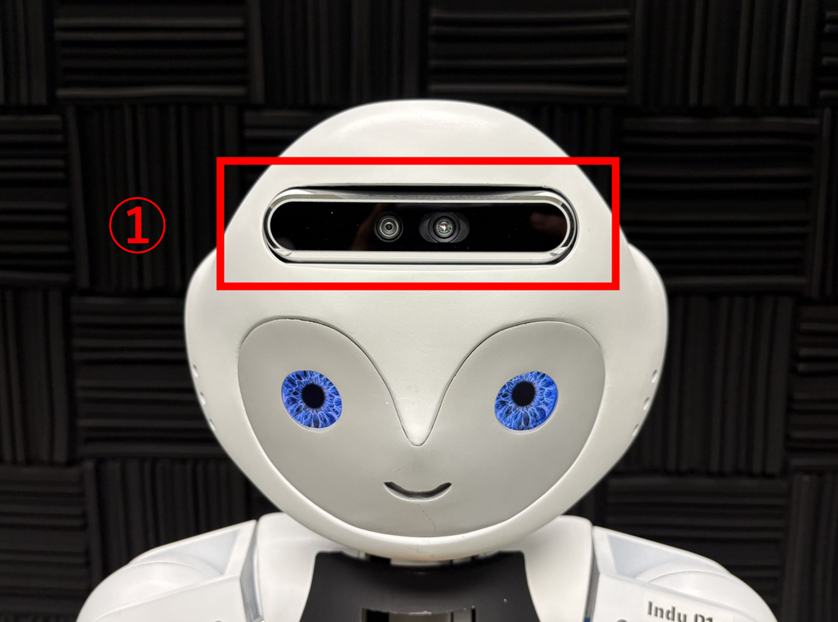|
|2|眼球ディスプレイ|頭部|眼の映像投影用|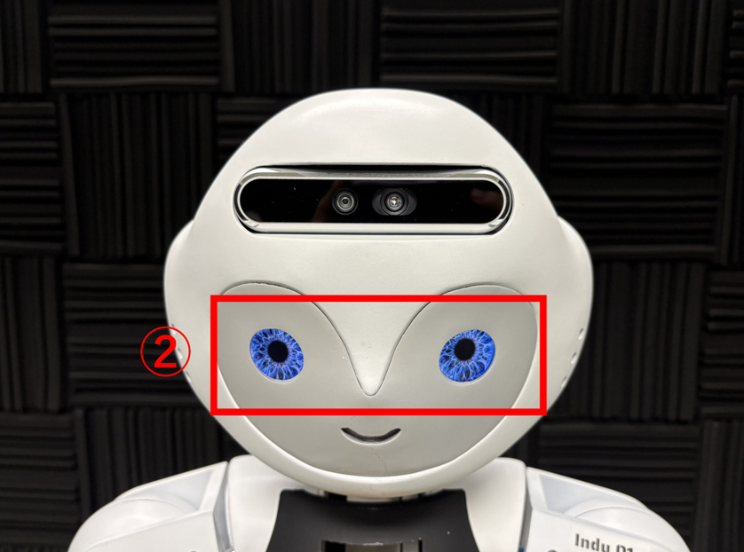|
|3|モータ ×3|頭/首部|首、上半身動作用|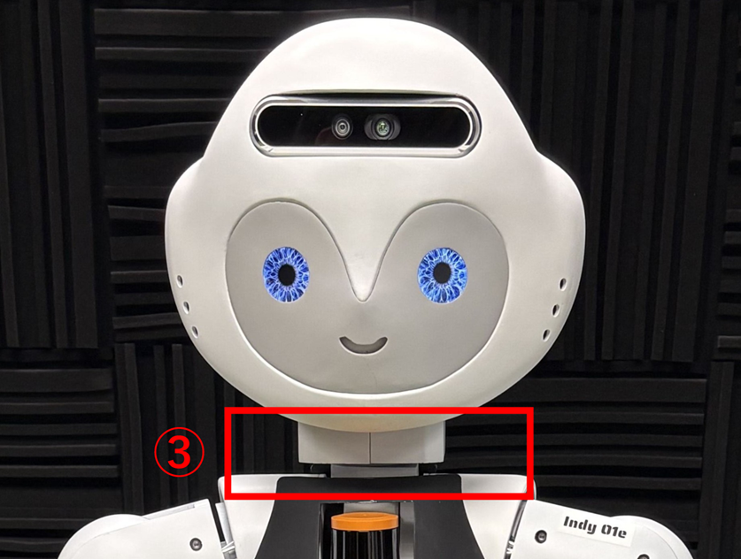|
|4|LiDAR|胸部|HumanTracker用|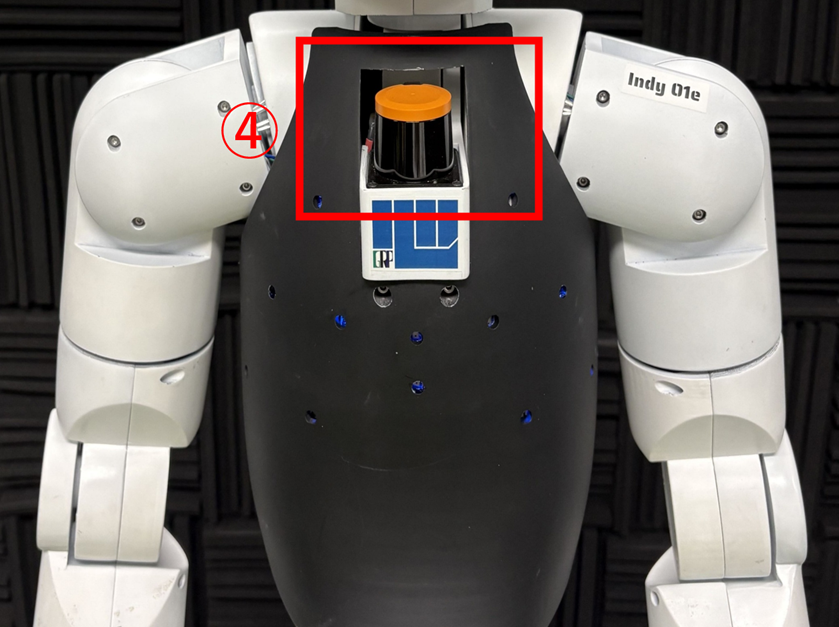|
|5|マイクロホンアレイ|胸部、背面|音声取得用|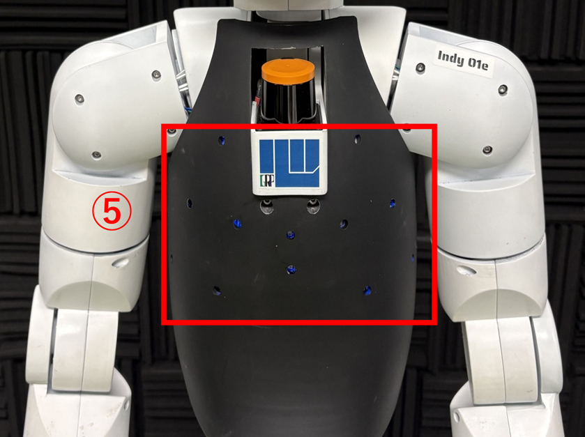|
|6|腕用モータ 左右各4つ|左右腕部|腕制御用|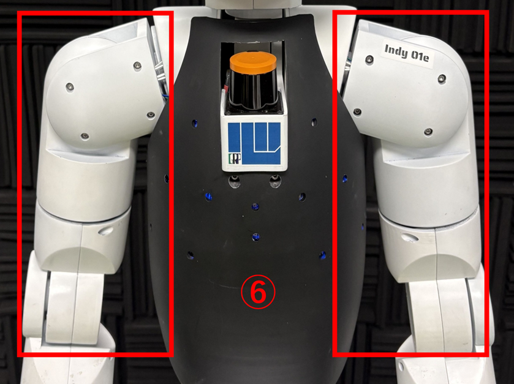|
|7|スピーカー ×2|ローバ上|発話用|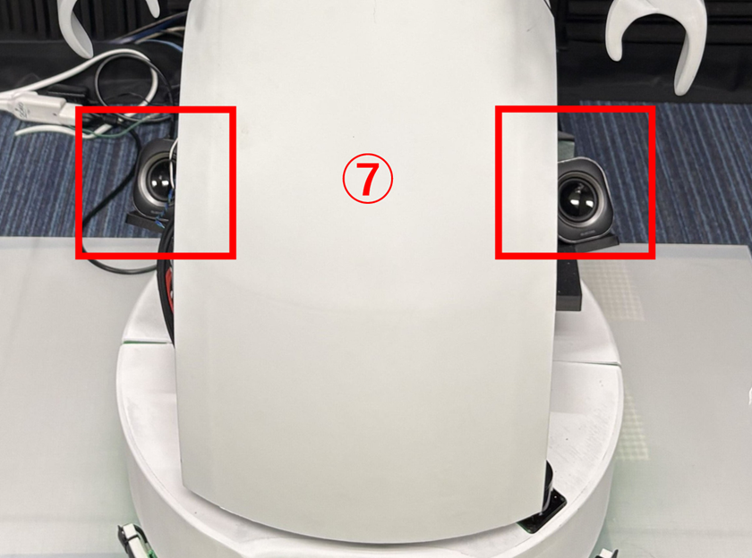|
|8|ローバ|ー|移動用|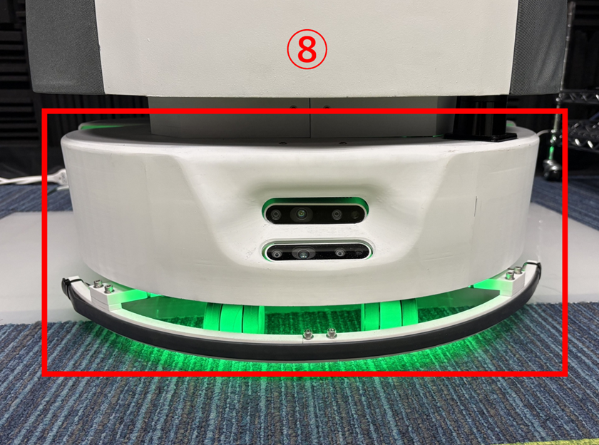|
|9|LiDAR ×2|足元|自己位置推定/ナビゲーション用|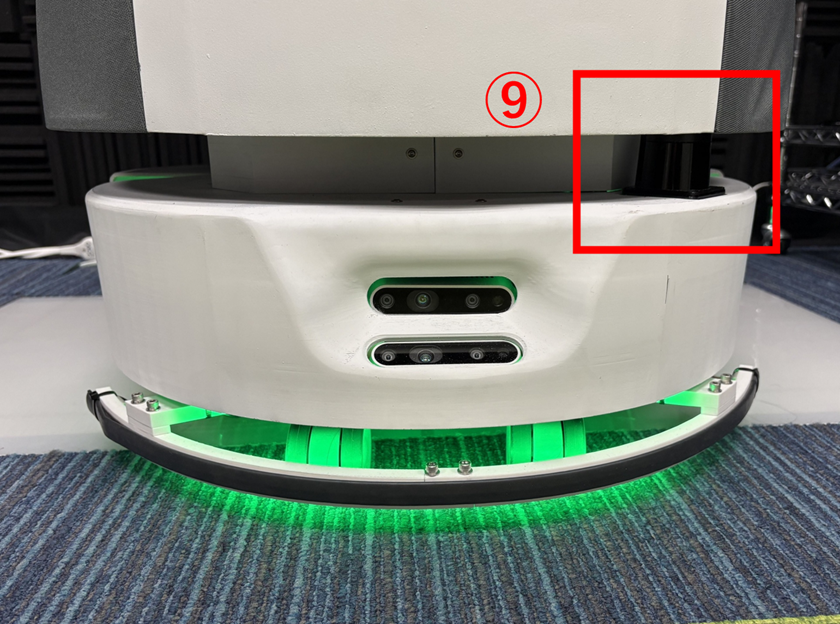|
|10|RealSense ×2|足元|ナビゲーション用|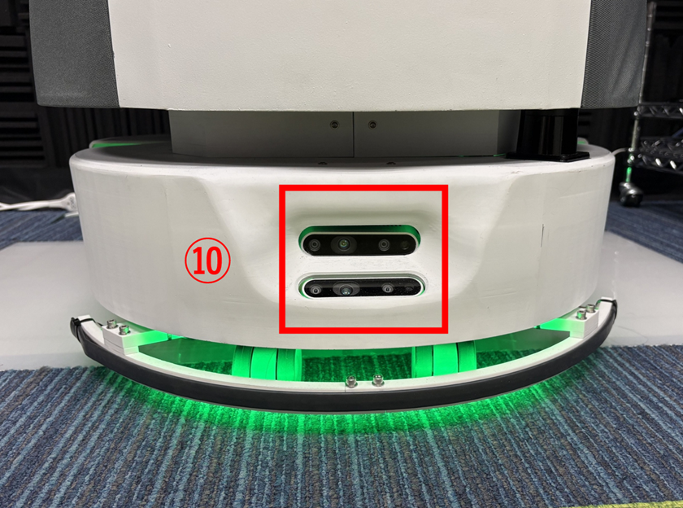|
|11|バンパセンサ|足元|衝突感知用|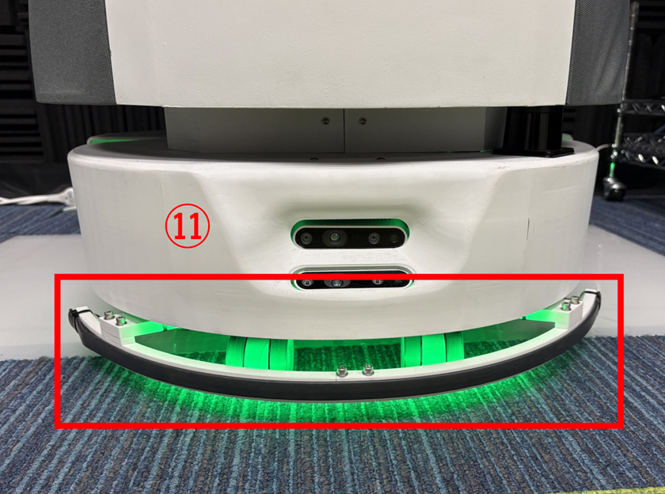|

- Indyには非常停止ボタンが搭載されており、押下することで以下の機器への電源供給が遮断される。
  - No.3 モータ
  - No.6 腕用モータ
  - No.8 ローバ
  - No.11 バンパセンサ  
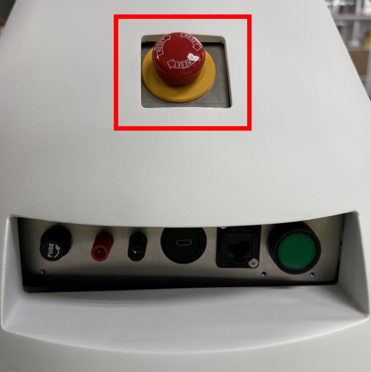
